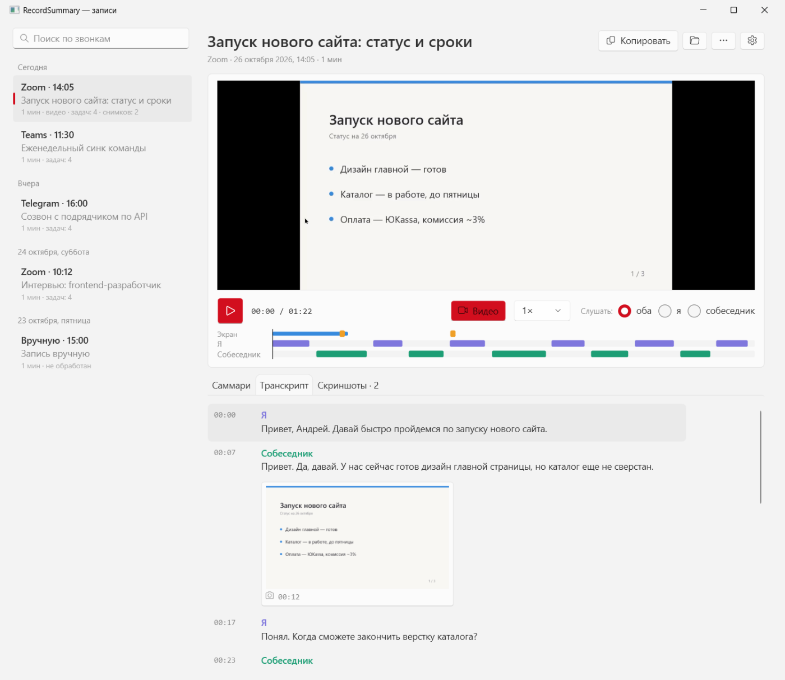
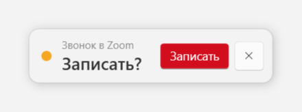
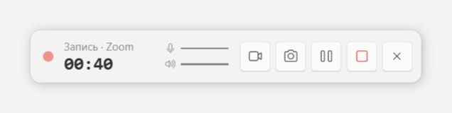
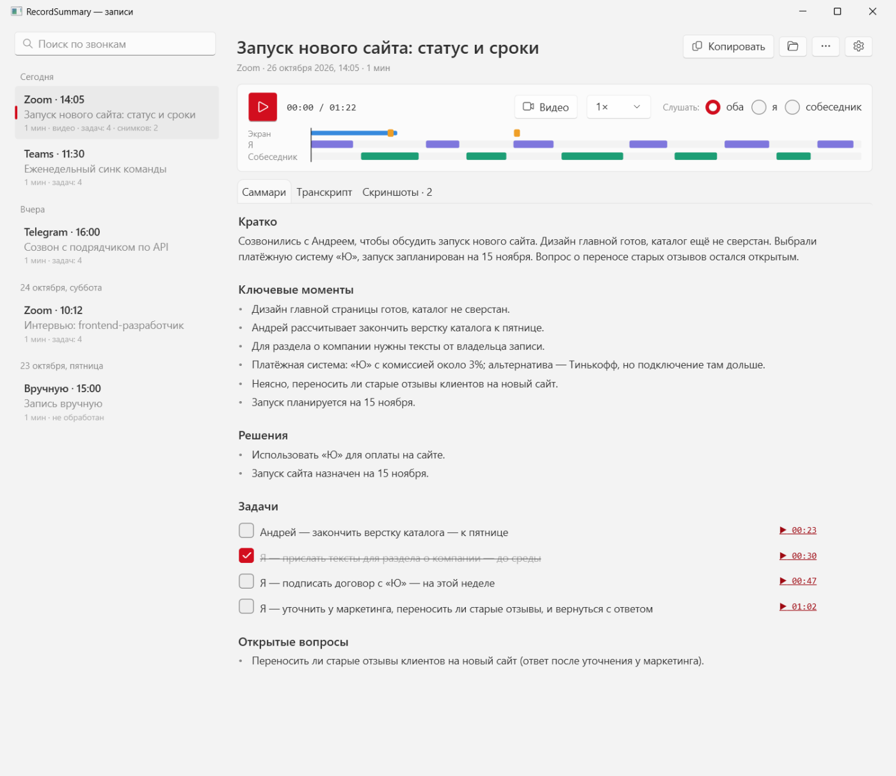
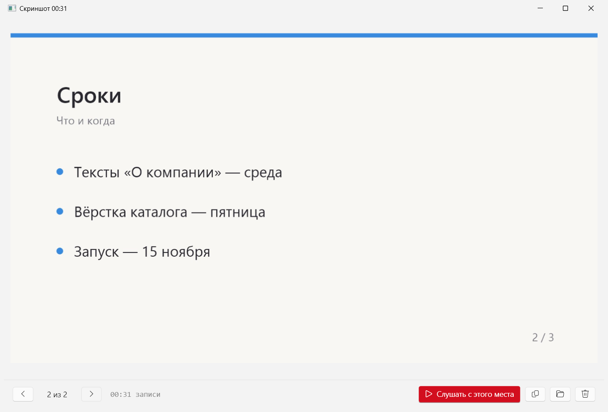
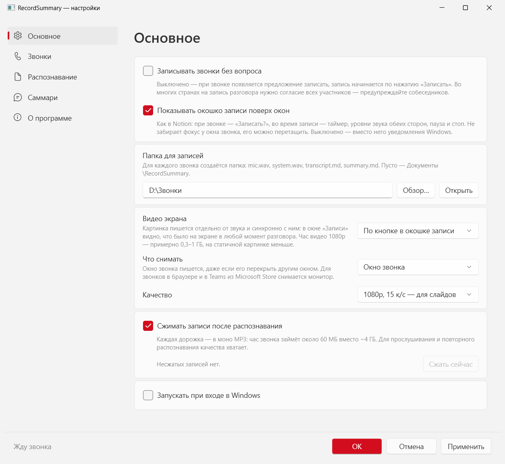
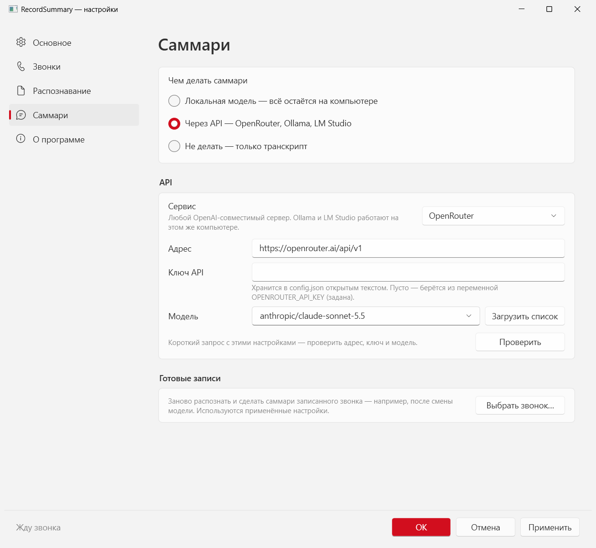

# RecordSummary

Приложение в трее: замечает звонок (Zoom, Teams, Телемост, Telegram, Discord, браузер…), записывает его двумя дорожками
и после звонка делает транскрипт и саммари с задачами. Во время звонка можно делать скриншоты и писать видео экрана —
всё привязано ко времени разговора.



- **Детектор** — по реестру Windows видит, какое приложение держит микрофон (`CallDetector.cs`).
- **Запись** — `mic.wav` (вы) и `system.wav` (собеседники, WASAPI loopback с устройства, куда приложение звонка выводит звук). Раздельные дорожки = «Я / собеседники».
- **Собеседники** — системная дорожка делится по голосам (sherpa-onnx: pyannote + эмбеддинги голоса, на процессоре): «Собеседник 1», «Собеседник 2»…
- **Транскрипция** — whisper.cpp (Whisper.net, Vulkan) по кускам речи из Silero VAD, на этом компьютере.
- **Саммари** — локальная gguf-модель (LLamaSharp) или любой OpenAI-совместимый API (OpenRouter, Ollama, LM Studio).

Записи: `Документы\RecordSummary\<дата> <приложение>\`.

## Плашка записи

Как в Notion — маленькое окошко поверх всех окон (по умолчанию в правом нижнем углу, можно перетащить, место запоминается).
Не забирает фокус у окна звонка и не видна в Alt+Tab.

| Звонок замечен | Идёт запись |
|---|---|
|  |  |

- звонок замечен — «Звонок в Zoom · Записать?»; висит, пока идёт звонок или пока её не закроют;
- идёт запись — таймер, уровни звука «я / собеседник» и кнопки: видео, скриншот, пауза, стоп (сразу распознать
  и сделать саммари), скрыть;
- пауза вырезается из записи: обе дорожки и видео останавливаются и продолжают совпадать по времени;
- **скриншот** — снимок монитора с окном звонка в `screenshots/чч-мм-сс.jpg` (время записи);
- **видео** — запись экрана (ScreenRecorderLib: Windows.Graphics.Capture + аппаратный H.264). Снимается окно приложения
  звонка, даже перекрытое другими окнами (для браузера и Teams из Store — монитор). Только картинка: звук — в наших
  дорожках. Каждое включение — фрагмент `video/чч-мм-сс--чч-мм-сс.mp4` (начало и конец во времени записи).
- захваченное окно или монитор отмечается системной рамкой Windows 11; кнопка выбора источника рядом с видео
  (и «Выбрать окно для видео…» в трее) открывает список окон и мониторов. Источник можно сменить во время звонка:
  звук продолжается, видео сохраняется новым фрагментом. Выбор действует до конца текущей записи;
- новые видеофрагменты содержат миллисекунды в имени, чтобы быстрые переключения не перезаписывали друг друга;
  старые записи без миллисекунд также поддерживаются.

Сама плашка не попадает ни в скриншоты, ни в демонстрацию экрана в Zoom/Teams (`WDA_EXCLUDEFROMCAPTURE`, Windows 10 2004+).
Скрытую во время записи плашку можно вернуть из меню трея; там же «Пауза», «Скриншот» и «Записывать видео».
Выключается в настройках — тогда вместо неё уведомления Windows.

## Окно «Записи»

Двойной клик по значку в трее (или «Записи…» в меню, или повторный запуск exe).



- слева — звонки по дням, поиск по названиям, саммари и транскриптам, ход обработки;
- плеер — скорость до 2× без изменения голоса, «слушать оба / я / собеседник»;
- видео экрана идёт над плеером синхронно со звуком; кнопка «Видео» прячет панель, двойной клик открывает фрагмент
  в проигрывателе;
- «Развернуть» в углу видео разворачивает окно и убирает список записей и текст: видео занимает свободное место,
  управление и полоса воспроизведения остаются снизу; «Свернуть» или Esc возвращает прежний вид и размер окна;
- карта разговора — кто когда говорил, фрагменты видео (синие полосы) и скриншоты (оранжевые метки); клик — перемотка;
- «Саммари» — у задач галочки (сохраняются в `summary.md`) и ссылка на момент разговора, где о задаче договорились;
- «Транскрипт» — клик по реплике включает запись с этого места, текущая реплика подсвечивается, скриншоты стоят
  между репликами в момент снимка;
- «Скриншоты» — все снимки звонка; просмотр со стрелками, «Слушать с этого места», копирование, удаление в корзину;
- «Копировать» — саммари в Markdown; «…» — переименовать, заново сделать саммари (по готовому транскрипту),
  распознать заново, удалить (в корзину).



## Хранение

После распознавания дорожки сжимаются в моно MP3 64 кбит/с (кодировщик Windows, без внешних библиотек):
час звонка — около 56 МБ вместо ~4 ГБ wav. Wav удаляется, только если сжатый файл открылся и совпал по длительности.
Видео 1080p — примерно 0,3–1 ГБ в час, на статичной картинке меньше.

## Настройки

| Основное | Саммари |
|---|---|
|  |  |

Всё хранится в `config.json` рядом с exe:

| Ключ | Что делает |
|---|---|
| `AutoRecord` | `true` — писать сразу, `false` — спрашивать |
| `ShowRecordingWidget` | плашка записи поверх окон (иначе — уведомления Windows) |
| `VideoMode`, `VideoSource`, `VideoMaxHeight`, `VideoFramerate` | видео: `button` / `always` / `off`, `window` / `screen`, качество |
| `CompressAudio` | сжимать дорожки в MP3 после распознавания |
| `WhisperModel`, `Language` | модель whisper (скачается сама, ~550 МБ) и язык |
| `SplitSpeakers`, `SpeakerCount`, `SpeakerThreshold` | разделять собеседников по голосу (модели ~32 МБ скачаются сами); число собеседников, если известно (0 — по голосам); порог похожести голосов (больше — меньше собеседников) |
| `SummaryProvider` | `local`, `api` или `off` |
| `SummaryPrompt` | свой промт для саммари; пусто — встроенный |
| `LocalModel`, `LocalModelUrl`, `LocalContextSize` | gguf для саммари (по умолчанию Qwen2.5-7B Q4, ~4,7 ГБ, скачается сама) |
| `ApiBaseUrl`, `ApiKey`, `ApiModel` | OpenRouter по умолчанию; ключ можно не писать, а задать `OPENROUTER_API_KEY` |

Тот же `api` подходит для локальных серверов: Ollama — `http://localhost:11434/v1`, LM Studio — `http://localhost:1234/v1`.
Длинный звонок, который не влезает в контекст модели, саммаризируется по частям: заметки по фрагментам, затем итог.

## Сборка

Windows 10/11 x64, .NET 10 SDK, Visual C++ Redistributable x64 (нужен библиотеке записи видео).

```
dotnet build src -c Release
```

Debug-сборка запускается рядом с рабочей Release (отдельный mutex), не мешая ей.

## Проверка без звонка

```
RecordSummary.exe --detect                    кто сейчас держит микрофон
RecordSummary.exe --record 10                 записать 10 с
RecordSummary.exe --video 10 папка [exe]      записать 10 с видео (окно этого exe или монитор)
RecordSummary.exe --process "папка звонка"    транскрипт и саммари готовой записи
RecordSummary.exe --summary "папка звонка"    только саммари по готовому транскрипту
```
Результат — в `recordsummary.log`. Для скриншотов документации `RECORDSUMMARY_SHOW_IN_CAPTURE=1` оставляет плашку
видимой для захвата экрана.
